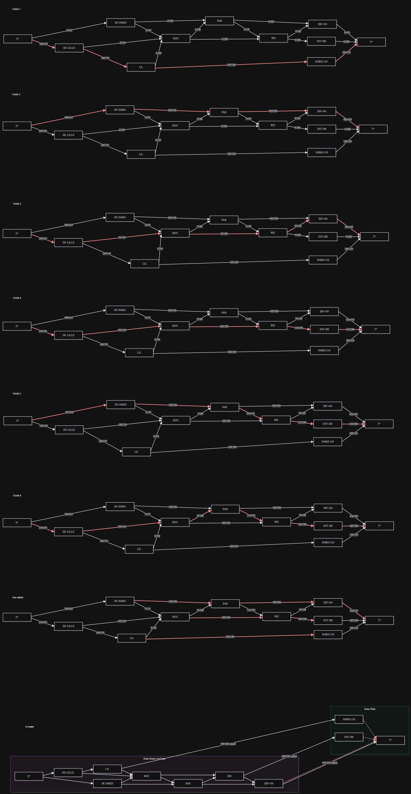

PARCOURS DE LA BOUCLE CALCULER FLOT DU TP 1 :

Pour `graph_data_C` dans `TP1.py`, la source et le puits sont :

```text
source = S*
puit = T*
```

Convention ci-dessous :

- `debits` contient tous les arcs originaux ;
- pour alléger `residual`, je n’affiche que les arcs dont la capacité résiduelle est positive ;
- les arcs non affichés dans `residual` ont une capacité résiduelle égale à `0`.

## État initial

```python
debits = {
    "S*->DC-LILLE": 0, "S*->DC-PARIS": 0,
    "DC-LILLE->LIL": 0, "DC-LILLE->ROU": 0,
    "DC-PARIS->ROU": 0, "DC-PARIS->PAR": 0,
    "LIL->NORD-250": 0, "LIL->ROU": 0,
    "PAR->IDF-430": 0, "PAR->REI": 0,
    "ROU->PAR": 0, "ROU->REI": 0,
    "REI->IDF-430": 0, "REI->EST-280": 0,
    "NORD-250->T*": 0, "IDF-430->T*": 0,
    "EST-280->T*": 0
}
```

Les capacités positives de `residual` sont les capacités initiales :

```text
S*→DC-LILLE=420, S*→DC-PARIS=650
DC-LILLE→LIL=350, DC-LILLE→ROU=220
DC-PARIS→ROU=250, DC-PARIS→PAR=500
LIL→NORD-250=160, LIL→ROU=240
PAR→IDF-430=400, PAR→REI=320
ROU→PAR=280, ROU→REI=180
REI→IDF-430=100, REI→EST-280=260
NORD-250→T*=250, IDF-430→T*=430, EST-280→T*=280
```

```text
Valeur totale = 0
```

---

## Tour 1

### `parent`

```python
{
    "S*": None,
    "DC-LILLE": "S*",
    "DC-PARIS": "S*",
    "LIL": "DC-LILLE",
    "ROU": "DC-LILLE",
    "PAR": "DC-PARIS",
    "NORD-250": "LIL",
    "REI": "ROU",
    "IDF-430": "PAR",
    "T*": "NORD-250"
}
```

### `path`

```python
[
    ("S*", "DC-LILLE"),
    ("DC-LILLE", "LIL"),
    ("LIL", "NORD-250"),
    ("NORD-250", "T*")
]
```

### `quantite_a_ajouter`

```text
min(420, 350, 160, 250) = 160
```

### `debits` après le tour

```text
S*→DC-LILLE=160
DC-LILLE→LIL=160
LIL→NORD-250=160
NORD-250→T*=160
```

Tous les autres débits valent `0`.

### `residual` positif après le tour

```text
S*→DC-LILLE=260, DC-LILLE→S*=160
S*→DC-PARIS=650
DC-LILLE→LIL=190, LIL→DC-LILLE=160
DC-LILLE→ROU=220
DC-PARIS→ROU=250, DC-PARIS→PAR=500
LIL→ROU=240
PAR→IDF-430=400, PAR→REI=320
ROU→PAR=280, ROU→REI=180
REI→IDF-430=100, REI→EST-280=260
NORD-250→T*=90, T*→NORD-250=160
IDF-430→T*=430
EST-280→T*=280
```

```text
Valeur totale = 160
```
---

## Tour 2

### `parent`

```python
{
    "S*": None,
    "DC-LILLE": "S*",
    "DC-PARIS": "S*",
    "LIL": "DC-LILLE",
    "ROU": "DC-LILLE",
    "PAR": "DC-PARIS",
    "REI": "ROU",
    "IDF-430": "PAR",
    "EST-280": "REI",
    "T*": "IDF-430"
}
```

### `path`

```python
[
    ("S*", "DC-PARIS"),
    ("DC-PARIS", "PAR"),
    ("PAR", "IDF-430"),
    ("IDF-430", "T*")
]
```

### `quantite_a_ajouter`

```text
min(650, 500, 400, 430) = 400
```

### `debits` après le tour

```text
S*→DC-LILLE=160
S*→DC-PARIS=400
DC-LILLE→LIL=160
DC-PARIS→PAR=400
LIL→NORD-250=160
PAR→IDF-430=400
NORD-250→T*=160
IDF-430→T*=400
```

Tous les autres débits valent `0`.

### `residual` positif après le tour

```text
S*→DC-LILLE=260, DC-LILLE→S*=160
S*→DC-PARIS=250, DC-PARIS→S*=400
DC-LILLE→LIL=190, LIL→DC-LILLE=160
DC-LILLE→ROU=220
DC-PARIS→ROU=250
DC-PARIS→PAR=100, PAR→DC-PARIS=400
LIL→ROU=240
PAR→REI=320
ROU→PAR=280, ROU→REI=180
REI→IDF-430=100, REI→EST-280=260
NORD-250→T*=90, T*→NORD-250=160
IDF-430→T*=30, T*→IDF-430=400
EST-280→T*=280
```

```text
Valeur totale = 560
```

---

## Tour 3

### `parent`

```python
{
    "S*": None,
    "DC-LILLE": "S*",
    "DC-PARIS": "S*",
    "LIL": "DC-LILLE",
    "ROU": "DC-LILLE",
    "PAR": "DC-PARIS",
    "REI": "ROU",
    "IDF-430": "REI",
    "EST-280": "REI",
    "T*": "IDF-430"
}
```

### `path`

```python
[
    ("S*", "DC-LILLE"),
    ("DC-LILLE", "ROU"),
    ("ROU", "REI"),
    ("REI", "IDF-430"),
    ("IDF-430", "T*")
]
```

### `quantite_a_ajouter`

```text
min(260, 220, 180, 100, 30) = 30
```

### `debits` après le tour

```text
S*→DC-LILLE=190
S*→DC-PARIS=400
DC-LILLE→LIL=160
DC-LILLE→ROU=30
DC-PARIS→PAR=400
LIL→NORD-250=160
PAR→IDF-430=400
ROU→REI=30
REI→IDF-430=30
NORD-250→T*=160
IDF-430→T*=430
```

### `residual` positif après le tour

```text
S*→DC-LILLE=230, DC-LILLE→S*=190
S*→DC-PARIS=250, DC-PARIS→S*=400
DC-LILLE→LIL=190, LIL→DC-LILLE=160
DC-LILLE→ROU=190, ROU→DC-LILLE=30
DC-PARIS→ROU=250
DC-PARIS→PAR=100, PAR→DC-PARIS=400
LIL→ROU=240
PAR→REI=320
ROU→PAR=280
ROU→REI=150, REI→ROU=30
REI→IDF-430=70, IDF-430→REI=30
REI→EST-280=260
NORD-250→T*=90, T*→NORD-250=160
T*→IDF-430=430
EST-280→T*=280
```

```text
Valeur totale = 590
```

---

## Tour 4

### `parent`

```python
{
    "S*": None,
    "DC-LILLE": "S*",
    "DC-PARIS": "S*",
    "LIL": "DC-LILLE",
    "ROU": "DC-LILLE",
    "PAR": "DC-PARIS",
    "REI": "ROU",
    "IDF-430": "REI",
    "EST-280": "REI",
    "T*": "EST-280"
}
```

### `path`

```python
[
    ("S*", "DC-LILLE"),
    ("DC-LILLE", "ROU"),
    ("ROU", "REI"),
    ("REI", "EST-280"),
    ("EST-280", "T*")
]
```

### `quantite_a_ajouter`

```text
min(230, 190, 150, 260, 280) = 150
```

### `debits` après le tour

```text
S*→DC-LILLE=340
S*→DC-PARIS=400
DC-LILLE→LIL=160
DC-LILLE→ROU=180
DC-PARIS→PAR=400
LIL→NORD-250=160
PAR→IDF-430=400
ROU→REI=180
REI→IDF-430=30
REI→EST-280=150
NORD-250→T*=160
IDF-430→T*=430
EST-280→T*=150
```

### `residual` positif après le tour

```text
S*→DC-LILLE=80, DC-LILLE→S*=340
S*→DC-PARIS=250, DC-PARIS→S*=400
DC-LILLE→LIL=190, LIL→DC-LILLE=160
DC-LILLE→ROU=40, ROU→DC-LILLE=180
DC-PARIS→ROU=250
DC-PARIS→PAR=100, PAR→DC-PARIS=400
LIL→ROU=240
PAR→REI=320
ROU→PAR=280
REI→ROU=180
REI→IDF-430=70, IDF-430→REI=30
REI→EST-280=110, EST-280→REI=150
NORD-250→T*=90, T*→NORD-250=160
T*→IDF-430=430
EST-280→T*=130
```

```text
Valeur totale = 740
```

---

## Tour 5

### `parent`

```python
{
    "S*": None,
    "DC-LILLE": "S*",
    "DC-PARIS": "S*",
    "LIL": "DC-LILLE",
    "ROU": "DC-LILLE",
    "PAR": "DC-PARIS",
    "REI": "PAR",
    "IDF-430": "REI",
    "EST-280": "REI",
    "T*": "EST-280"
}
```

### `path`

```python
[
    ("S*", "DC-PARIS"),
    ("DC-PARIS", "PAR"),
    ("PAR", "REI"),
    ("REI", "EST-280"),
    ("EST-280", "T*")
]
```

### `quantite_a_ajouter`

```text
min(250, 100, 320, 110, 130) = 100
```

### `debits` après le tour

```text
S*→DC-LILLE=340
S*→DC-PARIS=500
DC-LILLE→LIL=160
DC-LILLE→ROU=180
DC-PARIS→PAR=500
LIL→NORD-250=160
PAR→IDF-430=400
PAR→REI=100
ROU→REI=180
REI→IDF-430=30
REI→EST-280=250
NORD-250→T*=160
IDF-430→T*=430
EST-280→T*=250
```

### `residual` positif après le tour

```text
S*→DC-LILLE=80, DC-LILLE→S*=340
S*→DC-PARIS=150, DC-PARIS→S*=500
DC-LILLE→LIL=190, LIL→DC-LILLE=160
DC-LILLE→ROU=40, ROU→DC-LILLE=180
DC-PARIS→ROU=250
PAR→DC-PARIS=500
PAR→REI=220, REI→PAR=100
ROU→PAR=280
REI→ROU=180
REI→IDF-430=70, IDF-430→REI=30
REI→EST-280=10, EST-280→REI=250
NORD-250→T*=90, T*→NORD-250=160
T*→IDF-430=430
EST-280→T*=30
```

```text
Valeur totale = 840
```

---

## Tour 6

### `parent`

```python
{
    "S*": None,
    "DC-LILLE": "S*",
    "DC-PARIS": "S*",
    "LIL": "DC-LILLE",
    "ROU": "DC-LILLE",
    "PAR": "ROU",
    "REI": "PAR",
    "IDF-430": "REI",
    "EST-280": "REI",
    "T*": "EST-280"
}
```

### `path`

```python
[
    ("S*", "DC-LILLE"),
    ("DC-LILLE", "ROU"),
    ("ROU", "PAR"),
    ("PAR", "REI"),
    ("REI", "EST-280"),
    ("EST-280", "T*")
]
```

### `quantite_a_ajouter`

```text
min(80, 40, 280, 220, 10, 30) = 10
```

### `debits` après le tour

```text
S*→DC-LILLE=350
S*→DC-PARIS=500
DC-LILLE→LIL=160
DC-LILLE→ROU=190
DC-PARIS→PAR=500
LIL→NORD-250=160
PAR→IDF-430=400
PAR→REI=110
ROU→PAR=10
ROU→REI=180
REI→IDF-430=30
REI→EST-280=260
NORD-250→T*=160
IDF-430→T*=430
EST-280→T*=260
```

### `residual` positif final

```text
S*→DC-LILLE=70, DC-LILLE→S*=350
S*→DC-PARIS=150, DC-PARIS→S*=500
DC-LILLE→LIL=190, LIL→DC-LILLE=160
DC-LILLE→ROU=30, ROU→DC-LILLE=190
DC-PARIS→ROU=250
PAR→DC-PARIS=500
PAR→REI=210, REI→PAR=110
ROU→PAR=270, PAR→ROU=10
REI→ROU=180
REI→IDF-430=70, IDF-430→REI=30
EST-280→REI=260
NORD-250→T*=90, T*→NORD-250=160
T*→IDF-430=430
EST-280→T*=20, T*→EST-280=260
```

```text
Valeur totale = 850
```

---

## Tour 7 : arrêt

La BFS ne trouve plus de chemin résiduel entre `S*` et `T*`.

```python
parent = None
path = None
```

La condition suivante est exécutée :

```python
if path is None:
    break
```

## Résumé

| Tour | Chemin | Quantité ajoutée | Valeur totale |
|---:|---|---:|---:|
| 1 | `S* → DC-LILLE → LIL → NORD-250 → T*` | 160 | 160 |
| 2 | `S* → DC-PARIS → PAR → IDF-430 → T*` | 400 | 560 |
| 3 | `S* → DC-LILLE → ROU → REI → IDF-430 → T*` | 30 | 590 |
| 4 | `S* → DC-LILLE → ROU → REI → EST-280 → T*` | 150 | 740 |
| 5 | `S* → DC-PARIS → PAR → REI → EST-280 → T*` | 100 | 840 |
| 6 | `S* → DC-LILLE → ROU → PAR → REI → EST-280 → T*` | 10 | 850 |
| 7 | Aucun chemin | 0 | 850 |

La valeur finale du flot maximal est donc :

```text
850
```

Dans cette exécution précise, aucun chemin augmentant n’utilise effectivement un arc inverse, même si les arcs inverses sont bien présents dans `residual`.


Representation graphique :


